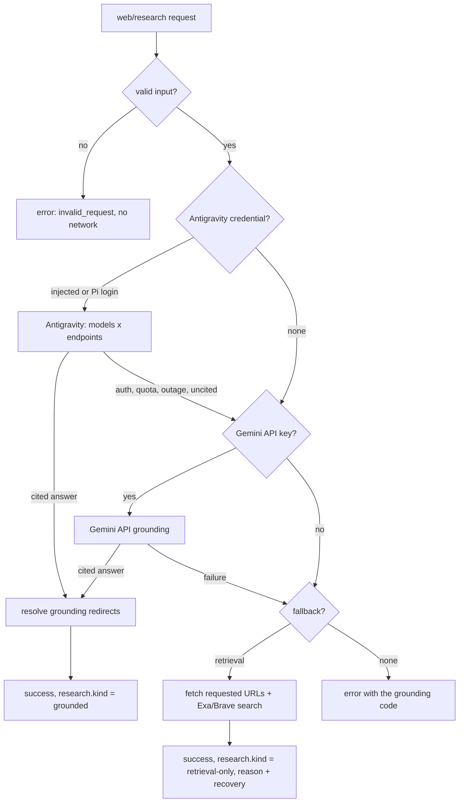

# Grounded research with Google Search

srch can answer a question with Google Search grounding and return the answer with claim-level citations. It uses the Antigravity account that is already signed in to Pi, so no extra API key is needed. When grounding is unavailable, srch returns retrieval results that are clearly labeled as retrieval-only, with the reason and the recovery step.

## When to use which

| Need | Use | Why |
| --- | --- | --- |
| Links and excerpts to read or rank | `web` (default strategy) | Exa answers in about 0.3 seconds and costs no quota |
| An answer to a question, with citations | `web` with strategy `web/research` | Google synthesizes a brief and maps each claim to sources |
| The exact text of a page | `fetch` | Extracted text, not a generated summary |

## SDK

```ts
const result = await client.run({
  domain: "web",
  strategy: "web/research",
  query: "What are the URL context limits?",
  urls: ["https://ai.google.dev/gemini-api/docs/url-context"], // optional, read with URL context
  instruction: "Prefer official documentation",                // optional, not an enforced filter
});

if (result.kind === "success" && result.research.kind === "grounded") {
  result.research.answer.text;          // generated brief: Findings, Gaps, Next checks
  result.research.answer.supports;      // [{ text, start, end, sourceIds }] with verified offsets
  result.research.answer.sources;       // [{ id, title, url, groundingUrl, resolved }]
  result.research.answer.queries;       // searches Google ran
  result.research.answer.urlRetrievals; // status of each requested URL
}
if (result.kind === "success" && result.research.kind === "retrieval-only") {
  result.research.reason;   // { code, message, recovery }
  result.evidence;          // fetched requested pages, then web results; no answer was generated
}
```

`renderGroundedAnswer(answer)` and `citeGroundedAnswer(answer)`, exported from `srch`, produce the Markdown brief that the CLI prints.

## CLI

```bash
search web "what changed in the node test runner" --research
search web "limits on this page" --research --url https://ai.google.dev/gemini-api/docs/url-context --json
search web "q" --research --no-fallback      # fail instead of degrading
search web "q" --research --transport gemini-api
```

## How a request flows



## Credentials

srch looks for an Antigravity credential in this order:

1. An injected secret named `antigravityCredentials` with JSON `{"token","projectId"}`. A host such as a Pi extension can supply it from its own auth lifecycle.
2. The Antigravity account in Pi's `auth.json` (`$PI_CODING_AGENT_DIR` or `~/.pi/agent`). srch reads this file and never writes it.

When the stored token has expired, srch refreshes it in memory by calling the installed pi-antigravity package (`refreshAntigravityToken`). srch also takes the client fingerprint and endpoint list from that package, so it does not copy OAuth client credentials or a client version string. Concurrent requests share one refresh. If the service rejects a token before it expires, srch refreshes once and retries.

Local auth is on for the default runtime and off when a caller injects `http` or `secrets`, so tests and sandboxed hosts never read a user's login by accident. Set `createClient({ localAuth: true })` to opt back in.

`SRCH_PI_ANTIGRAVITY_DIR` overrides where pi-antigravity is loaded from. Without pi-antigravity, a fresh token still works with built-in endpoints, but an expired token reports `auth_expired`.

`search inspect tools --json` shows `providers.google.antigravity`: whether an account is signed in, whether the session is fresh, minutes to expiry, and whether refresh is available. It never prints credential values.

## Failure handling

| Condition | Behavior |
| --- | --- |
| 401 or 403 | Stop that transport. Refresh once if the token came from Pi, otherwise report `auth_rejected` |
| 429 | Skip the model's other endpoints, cool the model down for Retry-After (default 60 seconds, at most 15 minutes), try the next model |
| 404, retired model | Next endpoint or next model |
| 5xx, network error, non-JSON | Next endpoint |
| Answer without source URLs | Never success. Counted as `uncited_answer`, next transport |
| Grounding stalls | Grounding gets the deadline minus 20 seconds, so retrieval can still answer |
| Caller cancels | Stop, no fallback |
| Answer text missing | Never success. Counted as `invalid_response`, next transport |
| All grounding fails | Retrieval-only result from fetched URLs and Exa/Brave only, or an error with `--no-fallback`. Gemini and Perplexity are excluded because they generate answers, and URL fetching skips Gemini URL-context extraction |
| Retrieval also fails | Error `research_unavailable` that names both failures |

The reported reason is the failure of a transport that was actually tried. A later skip for missing credentials does not hide it.

Quota cooldowns are scoped to the quota identity: the Antigravity project ID, or a truncated hash of the Gemini API key. One account's 429 never blocks another account.

`web/research` rejects `domainFilter`, `recencyFilter`, `includeContent`, `provider`, and `hq` with `unsupported_option` before any credential lookup or request.

## Provider order for plain web search

Automatic web search tries `exa, google, brave, gemini, perplexity`. Providers without credentials are skipped. Google and Gemini share the Gemini API wire, so it is called at most once. Change the order per request with `providers: [...]` or `--providers`, or persistently with `search config set web-providers google,exa`.

Exa stays first because it measured better for link retrieval. A paired live run of 16 queries on 2026-11-16 (the repository's six evaluation cases plus ten documentation and current-fact queries, scored by `scoreWebEvaluation`) gave these results:

| Provider | Expected source found | Excerpt coverage at 5 | p50 latency | p95 latency |
| --- | --- | --- | --- | --- |
| Exa MCP | 0.88 | 0.94 | 308 ms | 388 ms |
| Google via Antigravity | 0.81 | 0.74 | 2661 ms | 3889 ms |

Each provider had one transient failure, and both succeeded on retry. Google uses Antigravity quota on every call. Google is the better choice when you need an answer, so it is the engine for `web/research` and the second provider for plain search.

## Known limits

- Antigravity does not return URL-context metadata, so requested URLs report `unknown` unless the Gemini API transport is used. srch does not guess.
- The answer is generated. Claims without verified offsets keep their text but get no citation marker. Check important facts against the cited pages or with `fetch`.
- `answer.citations` is `claim-level` when at least one claim has offsets verified against the answer and cites an existing source, or `sources-only` when Google returned sources but no claim mapping. Treat `sources-only` answers as unverified.
- Grounding cannot enforce domain or recency filters. `web/research` rejects them, and plain search skips Google when they are set.
- The Antigravity wire is an internal Google API that pi-antigravity tracks. srch follows the installed package for endpoints and fingerprint, but a wire change can still break the transport until pi-antigravity updates. Plain search keeps working through the other providers.

## Retiring the separate `google_search` tool

`search web --research` covers what pi-antigravity's model-facing `google_search` tool did: lead instructions, URL context, thinking, claim citations, resolved sources, and executed queries. It adds structured results, fallback, and diagnostics. Once agents are using the search skill for research, set `ANTIGRAVITY_NO_SEARCH_TOOL=1` (or disable the extension resource in `pi config`). That keeps Antigravity models and `/antigravity.search` available as a rollback.
